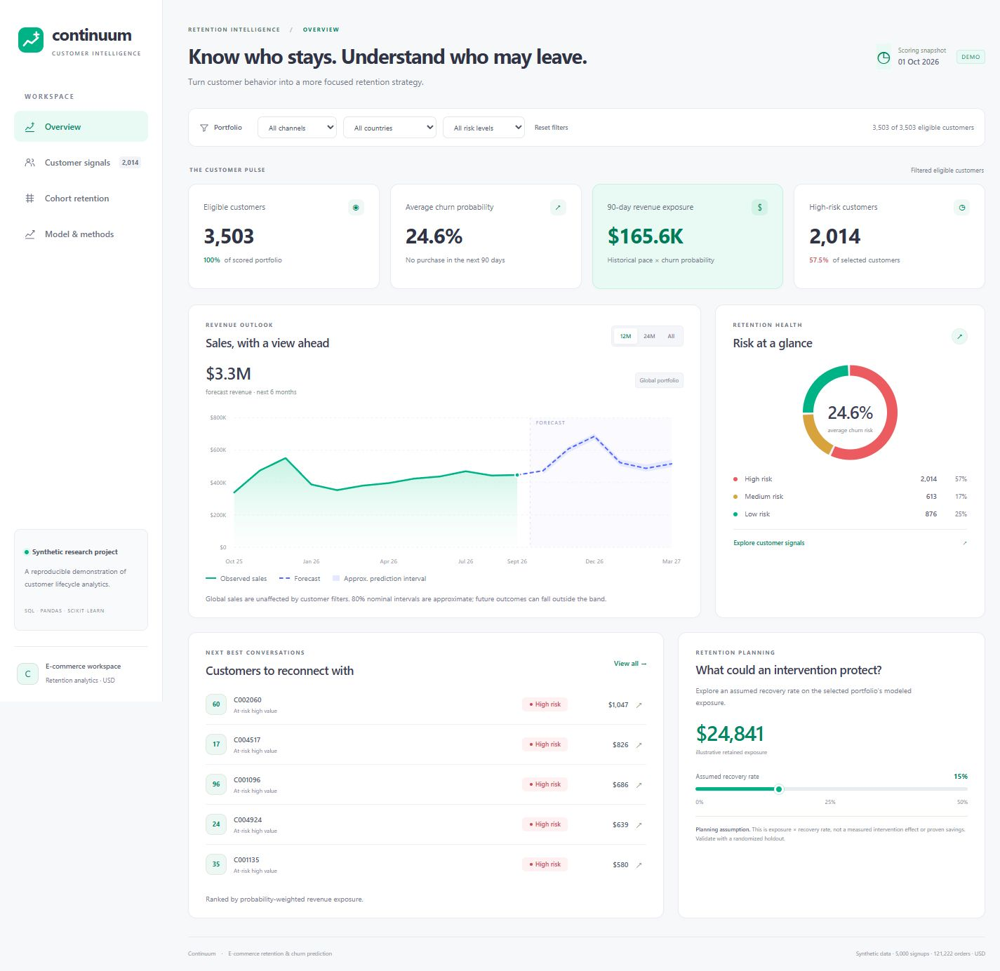

# E-Commerce Customer Retention & Churn Prediction

A complete analytics project connecting SQL customer lifecycle analysis, Pandas time-series features, Scikit-learn purchase-inactivity scoring, sales forecasting, and an interactive Tableau dashboard.

**[Open the live dashboard](https://rajshekharpro-retention.raj-6d6f.chatgpt.site)** · **[GitHub repository](https://github.com/rajshekharpro/ecommerce-retention)**



**All bundled data is synthetic.** It represents a fictional store, uses USD, and covers January 2023 through September 2026. Model scores and scenario estimates demonstrate a workflow; they do not establish real customer behavior or proven revenue savings.

## Open the finished project

- Open `dashboard/index.html` in any modern browser. It works offline and includes portfolio trends, cohorts, customer prioritization, model results, filters and CSV export.
- Open `tableau/Retention_Analytics.twbx` in Tableau. See `docs/tableau.md` for version requirements, filters, refresh instructions and native validation status.
- Read `artifacts/reports/metrics.json` for the actual model evaluation and `artifacts/reports/forecast_metrics.json` for forecast backtesting.
- Explore the SQL queries against `artifacts/retention.sqlite`.

The bundled run achieves test ROC-AUC **0.824**, average precision **0.598**, and **90.6% recall** at **38.8% precision**. The chosen six-month sales model has rolling-backtest WAPE **4.0%**. These are synthetic-data metrics; the forecast comparison shares its selection folds and is not an independent test. See `docs/validation.md` for completed checks and the native Tableau limitation.

On Windows, `./run_project.ps1` opens the browser dashboard. `./run_project.ps1 -Rebuild` regenerates data and analytics first.

## Reproduce the analysis

Python 3.11 or later is required. Use a virtual environment:

```powershell
python -m venv .venv
.\.venv\Scripts\Activate.ps1
python -m pip install -r requirements.txt
python -m retention.pipeline demo --customers 5000 --seed 42
python -m pytest -q
```

On macOS/Linux, activate with `source .venv/bin/activate`; the Python commands are the same. To serve the dashboard locally instead of opening its file, run `python -m http.server 8765 --directory dashboard --bind 127.0.0.1`, then open `http://127.0.0.1:8765`.

The demo command regenerates `data/raw`, `artifacts`, `dashboard/data.js`, and the Tableau workbook. The feature, model and dashboard source code stays editable. All paths resolve from the project location, so the project can be moved to another directory.

## Business question and population

Which established, recently purchasing customers are likely to make **no completed purchase in the next 90 days**, and where should a retention team concentrate its experiments?

At each scoring date, customers must have been signed up for at least 90 days and made a completed purchase in the preceding 180 days. New signups and customers dormant for more than 180 days are outside this model's population. The dashboard's scored-customer count therefore differs from total signups. A positive target is 90-day purchase inactivity, an operational churn proxy rather than permanent customer loss.

Dates are UTC calendar days. Feature windows include their lower boundary and exclude the snapshot date. Outcomes include the snapshot date and exclude the date 90 days later. A label is generated only when the entire outcome window is observed. Cancellations and refunded orders contribute neither purchases nor revenue. The revenue measure is completed-order value; it is not accounting net revenue.

## Analysis workflow

1. Generate reproducible signup and order data with varied acquisition, spending, seasonality, engagement decline and reactivation. Hidden generator behavior is never exported as a feature.
2. Validate keys, chronology, amounts, statuses and observation boundaries; load indexed SQLite tables.
3. Build recency, purchase frequency, order-value, tenure, interpurchase-gap and recent-activity features at quarterly cutoffs. Verify SQL/Pandas agreement on shared features and all cohort rows.
4. Compare models on a later validation period, choose the operating threshold there, and evaluate the frozen choice on an untouched later test period. Refit a separate production model on all mature labels.
5. Compare seasonal sales forecasting approaches with rolling-origin backtests. Export six future months with approximate uncertainty intervals.
6. Score the current eligible population, attach behavioral reasons and suggested retention experiments, and export tables for Tableau and the browser dashboard.

See `docs/modeling.md`, `docs/forecasting.md`, and `docs/data_dictionary.md` for definitions, assumptions and metrics.

## Reading the retention outputs

**Signup cohorts:** Each row starts with all customers acquired that month. The retained count is customers with at least one completed order in the corresponding calendar month, divided by the original signup cohort size. Month 0 need not be 100%. Future and partially observed months are omitted, not converted to zero.

**Revenue exposure:** Prior 180-day completed revenue divided by two is a simple 90-day revenue proxy. Multiplying it by inactivity probability yields a prioritization measure, `revenue_at_risk`. It is not a causal estimate of lost revenue. Scenario recovery is a user-supplied assumption and must be tested.

**Actions:** Behavioral rules suggest an intervention, such as a replenishment reminder, service outreach, product recommendations or a controlled win-back offer. Assign eligible customers randomly to treatment and holdout; measure incremental repeat purchase, contribution margin and unsubscribe rates. Apply consent rules, contact caps and unit economics before using real customer data. This project sends no communications.

## Project layout

```text
retention/        data generation, features, modeling, forecasting and CLI
sql/              schema, point-in-time features, cohorts and sales queries
tests/            boundary, leakage, integrity, model and workbook checks
data/raw/         synthetic customers, orders and generation metadata
artifacts/        SQLite database, model files, scores and evaluation results
dashboard/        offline interactive browser dashboard
tableau/          native workbook, packaged workbook and packaged data
docs/             data dictionary, methods and Tableau guide
scripts/          reproducible workbook builder
```

## Replacing the demo data

Prepare `customers.csv` and `orders.csv` following `docs/data_dictionary.md`, then run:

```powershell
python -m retention.pipeline run --raw-dir path/to/data --observation-end 2026-10-01
```

The observation end is exclusive and must represent the actual end of complete collection, not just the last observed purchase. Add `metadata.json` with `{"synthetic": false, "currency": "USD"}`. The shipped evaluation calendar expects mature history for 2024–2026 and nonempty training, validation and test populations. Adapt the snapshot calendar and model split settings together for a different observation period, and preserve full outcome maturity between splits. Use a single consistent currency or normalize amounts before ingestion. Do not load untrusted serialized model files.

## Sources for implementation choices

- [Scikit-learn: preventing data leakage](https://scikit-learn.org/stable/common_pitfalls.html)
- [Scikit-learn: evaluating time-dependent observations](https://scikit-learn.org/stable/modules/cross_validation.html)
- [Tableau: forecasting methods](https://help.tableau.com/current/pro/desktop/en-us/forecast_how_it_works.htm)

The shipped forecast is computed in Python and displayed in Tableau; Tableau's built-in exponential-smoothing forecast is an optional alternative documented separately.
